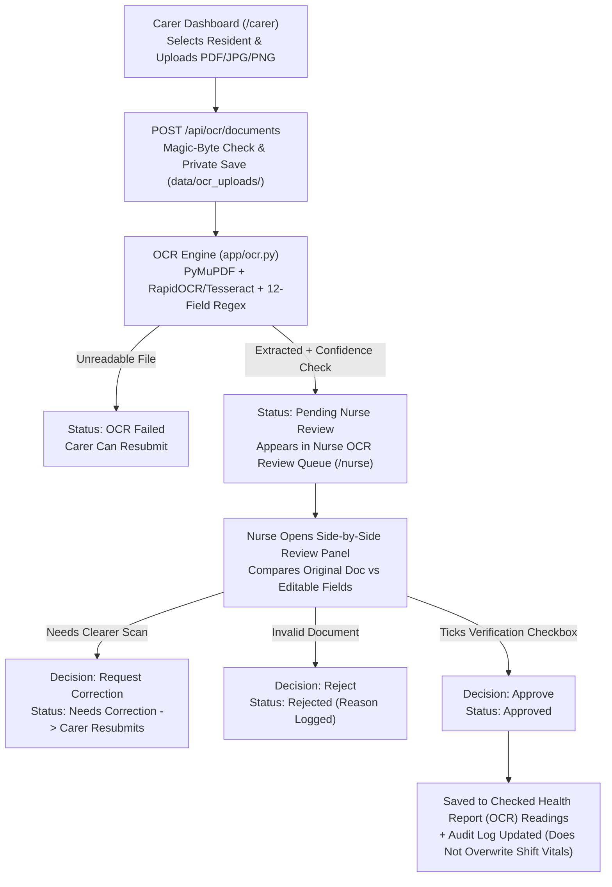
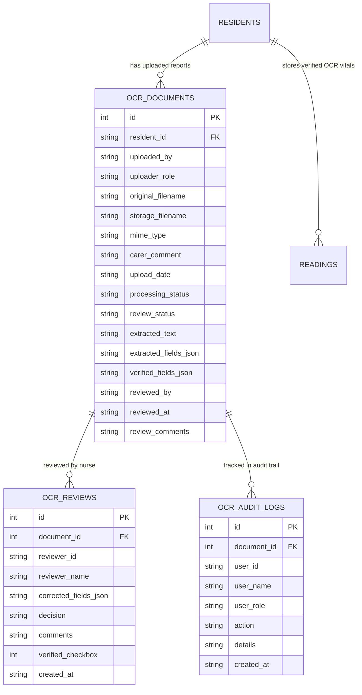

# Smart OCR Carer-to-Nurse Workflow: Literature Review, Architecture & Requirements Traceability

**Author:** Jaspreet Singh (`jpsingh4340@gmail.com`)  
**Course:** IA728001 Studio 5 (Level 7)  
**Project:** AgeCare — Care Signal Management System  

---

## 1. Literature Review & Domain Research (Objective 2.1)

### 1.1 Paper-to-Digital Bottlenecks in New Zealand Aged Residential Care
New Zealand's Aged Residential Care (ARC) sector cares for over 35,000 older adults across rest homes, hospital-level care, and dementia units (New Zealand Aged Care Association [NZACA], 2023). Despite the adoption of electronic care record systems such as VCare and eCase, external clinical correspondence—including hospital discharge summaries, specialist clinic letters, paper vital-sign observation charts, and allied health reports—frequently arrives in printed or scanned PDF/image formats (Ministry of Health NZ, 2022). Healthcare assistants (carers) and registered nurses spend significant shift time manually transcribing numerical observations and allergy updates from paper into electronic records, increasing cognitive load and transcription error rates.

### 1.2 Risks of Unverified OCR and AI Hallucination in Clinical Records
Studies on Optical Character Recognition (OCR) in clinical documentation highlight that while modern OCR engines achieve $>95\%$ character accuracy on clean print, degraded scans, creases, or low-contrast fonts can cause single-digit misrecognition (e.g., reading a blood pressure of `180/95` as `130/95` or a decimal temperature `38.5` as `36.5`) (Goodrum et al., 2020; Hegghammer, 2022). Furthermore, generative Large Language Models (LLMs) used for document extraction can "hallucinate" plausible-looking vital signs when text is ambiguous (Ji et al., 2023). In clinical informatics, **Human-in-the-Loop (HITL)** verification—where automated extraction is paired with physiological range checks, confidence scoring, and mandatory clinician sign-off—is recognised as the gold standard for preventing automation bias and patient harm (Lyell & Coiera, 2017).

### 1.3 Separating Historical Report Data from Live Early Warning Scores (NZEWS)
The New Zealand Early Warning Score (**NZEWS**), standardised by the Health Quality & Safety Commission (HQSC, 2020), calculates acute physiological deterioration from *current* bedside vital signs (respiration, $\text{SpO}_2$, temperature, blood pressure, heart rate). A critical clinical safety finding from our domain analysis is that vital signs extracted from a *historical* health report (such as a hospital discharge letter from three days ago) must **never** automatically overwrite a resident's current shift vital signs or trigger false Red/Amber NZEWS escalations. Instead, historical OCR report readings must be stored in a distinct verified report history (`Checked Health Report (OCR) Readings`) while bedside carer shift observations drive live NZEWS triage.

### 1.4 Privacy, Governance & NZ Health Information Privacy Code (HIPC 2020)
Under the **New Zealand Privacy Act 2020** and the **Health Information Privacy Code (HIPC) 2020**:
- **Rule 5 (Storage and Security of Health Information):** Health agencies must ensure health documents are protected against unauthorised access. Storing uploaded patient reports in a public web `/static/` directory violates Rule 5; therefore, our architecture stores files in a private directory (`data/ocr_uploads/`) served exclusively through an authenticated, role-checked streaming endpoint (`GET /api/ocr/documents/{doc_id}/file`).
- **Rule 9 & Rule 11 (Limits on Disclosure & Cross-Border Cloud Transfer):** Uploading identifiable resident medical reports to commercial external cloud OCR/LLM APIs introduces cross-border data sovereignty risks. Processing OCR locally on-premise using `RapidOCR` / `Tesseract` + `PyMuPDF` ensures $100\%$ of health data remains inside the facility's local network.
- **Role-Based Scope of Practice (Nursing Council of New Zealand, 2022):** Unregulated healthcare assistants (Carers) work under the delegation and direction of Registered Nurses (RNs). Carers can capture observations and upload documents, whereas only a Registered Nurse holds the clinical authority to verify, correct, and approve medical record updates.

### References
- Goodrum, H., Roberts, K., & Bernstam, E. V. (2020).Automatic classification of scanned electronic health record documents. *International Journal of Medical Informatics*, 144, 104302.
- Health Quality & Safety Commission New Zealand [HQSC]. (2020). *New Zealand Early Warning Score (NZEWS) National Vital Sign Chart User Guide*. Wellington: HQSC.
- Hegghammer, T. (2022). OCR with Tesseract, Amazon Textract, and Google Document AI: A benchmarking experiment. *Journal of Computational Social Science*, 5(1), 861–882.
- Ji, Z., Lee, N., Frieske, R., Yu, T., Su, D., Xu, Y., ... & Fung, P. (2023). Survey of hallucination in natural language generation. *ACM Computing Surveys*, 55(12), 1–38.
- Lyell, D., & Coiera, E. (2017). Automation bias and verification complexity: A systematic review. *Journal of the American Medical Informatics Association*, 24(2), 423–431.
- New Zealand Aged Care Association [NZACA]. (2023). *Aged Residential Care Industry Profile 2022–2023*. Wellington: NZACA.
- Office of the Privacy Commissioner NZ. (2020). *Health Information Privacy Code 2020*. Wellington, New Zealand.

---

## 2. Technology Evaluation & Decision Matrix (Objective 2.1)

We evaluated four candidate technical approaches for extracting clinical fields from uploaded PDF, JPG, and PNG health documents:

| Evaluation Criteria | Option A: Cloud OCR APIs (AWS Textract / Google Cloud Vision) | Option B: Pure Generative Vision-LLM (GPT-4o / Cloud VLM) | Option C: Manual Entry Only (Status Quo in Rest Homes) | **Option D (Selected): Local Hybrid OCR (`RapidOCR` + `Tesseract` + `PyMuPDF` + Deterministic Regex)** |
|---|---|---|---|---|
| **NZ HIPC 2020 Privacy & Data Sovereignty** | Low (sends patient documents to external cloud servers) | Low (external cloud API + training/retention concerns) | High (local) | **High (100% offline, local on-premise execution)** |
| **Protection Against Number Hallucination** | High (character-level OCR) | Low (LLMs can invent or round vital sign digits) | Medium (human typing errors) | **High (deterministic regex `FIELDS` + physiological `RANGES` validation)** |
| **Multi-Format Support (PDF, Scanned PDF, JPG, PNG)** | High | Medium | N/A | **High (`PyMuPDF` text layer + 200 DPI page rasterisation fallback + image OCR)** |
| **Operational Cost for Small NZ Rest Homes** | Ongoing per-page API fees | High per-token API fees | High staff time cost | **Zero ongoing API cost (open-source Python stack)** |
| **Works When Internet Is Down** | No | No | Yes | **Yes (runs completely on local clinic server)** |

---

## 3. System Architecture & Decomposed OCR Pipeline (Objectives 1.1, 1.2 & 3.3)

### 3.1 Six-Stage Decomposed OCR & Verification Pipeline
Instead of treating OCR as a single black box, `app/ocr.py` and `app/routers/ocr_workflow.py` implement a six-stage clinical safety pipeline:

1. **Stage 1 — Binary Magic-Byte, Extension & Size Validator (`_validate_upload` in `app/routers/ocr_workflow.py`)**:
   - Enforces maximum file size ($\le 10\text{ MB}$), checks allowed extensions (`.pdf`, `.png`, `.jpg`, `.jpeg`), and inspects raw binary magic bytes (`%PDF`, `\x89PNG\r\n\x1a\n`, `\xff\xd8\xff`) before storing files in `data/ocr_uploads/`.
2. **Stage 2 — Hybrid PDF & Image Text Extraction (`read_document_lines` in `app/ocr.py`)**:
   - For PNG/JPG images: runs local ONNX `RapidOCR` / `pytesseract` to extract bounding boxes `(x, top, bottom)` and per-line confidence scores `(0.0 - 1.0)`.
   - For PDFs: extracts embedded digital text via `PyMuPDF` (`fitz`); if a page is a scanned image with $<15$ characters of digital text, automatically rasterises the page at $200\text{ DPI}$ to PNG bytes and runs image OCR.
3. **Stage 3 — Geometric Row Grouping (`group_into_lines` in `app/ocr.py`)**:
   - Sorts text bounding boxes top-to-bottom by vertical midpoint `(top + bottom) / 2` and joins boxes on the same horizontal row within `max(10, 0.6 * height)` pixels left-to-right so field labels (`Blood pressure:`) stay paired with their values (`138/82 mmHg`).
4. **Stage 4 — Deterministic Clinical Field Extraction & Physiological Flagging (`extract_document_fields` in `app/ocr.py`)**:
   - Extracts 12 fields: `resident_name`, `dob`, `report_date`, `document_type`, `blood_pressure`, `pulse`, `temperature`, `spo2`, `weight`, `glucose`, `medications`, and `allergies`.
   - Flags `needs_check = True` whenever OCR confidence $< 0.70$, a physiological value falls outside normal adult ranges (`RANGES`), or critical identity fields (`resident_name`, `report_date`) are missing.
5. **Stage 5 — Nurse Queue & Side-by-Side Verification Gate (`static/index.html`, `POST /api/ocr/documents/{doc_id}/review`)**:
   - Places the document into the Nurse Dashboard **OCR Review Queue** (`Pending Nurse Review`).
   - Displays the original document side-by-side with editable fields. The **Approve** button is disabled in both frontend UI and backend API (`400 Bad Request`) unless a user with `role == "nurse"` ticks the mandatory legal verification checkbox.
6. **Stage 6 — Resident Record Integration & Immutable Audit Trail (`app/routers/ocr_workflow.py`, `app/decision.py`)**:
   - Saves verified vitals into `readings` (`Checked Health Report (OCR) Readings`) with the reviewing nurse's name and timestamp, updates resident allergies if verified, and writes every action to `ocr_reviews`, `ocr_audit_logs`, and `audit_log` without overwriting current shift vitals.

### 3.2 End-to-End Workflow Diagram

### 3.3 Database Entity-Relationship (ER) Diagram

---

## 4. Requirements & Traceability Matrix (Objective 1.1 & 1.2)

| Req ID | Requirement / User Story | Backend & Frontend Files | Automated Pytest Verification | Status |
|---|---|---|---|---|
| **REQ-OCR-01** | As a Carer, I want to select an assigned resident and upload a PDF, JPG, or PNG health document with an optional note for the nurse. | `static/carer.html`, `static/carer.js`, `app/routers/ocr_workflow.py` (`POST /api/ocr/documents`) | `tests/test_ocr_workflow.py::test_1_carer_uploads_document_successfully` | Passed |
| **REQ-OCR-02** | As a System, I want to extract text and 12 clinical fields from uploaded PNG/JPG images and group horizontal text boxes accurately. | `app/ocr.py` (`read_document_lines`, `group_into_lines`, `extract_document_fields`) | `tests/test_ocr_workflow.py::test_2_ocr_extracts_text_from_image`, `tests/test_ocr.py` | Passed |
| **REQ-OCR-03** | As a System, I want to extract text from both digital and scanned PDF reports using `PyMuPDF` and image OCR fallback. | `app/ocr.py` (`_read_pdf_lines`) | `tests/test_ocr_workflow.py::test_3_ocr_processes_scanned_pdf` | Passed |
| **REQ-OCR-04** | As a Carer, I want unreadable or blank uploads safely marked as `OCR Failed` rather than crashing the application. | `app/routers/ocr_workflow.py`, `app/ocr.py` | `tests/test_ocr_workflow.py::test_4_failed_ocr_displays_error_status` | Passed |
| **REQ-OCR-05** | As a Nurse, I want newly processed documents to appear automatically in the Nurse Dashboard OCR Review Queue with a pending counter badge. | `static/index.html`, `app/routers/ocr_workflow.py` (`GET /api/ocr/documents`) | `tests/test_ocr_workflow.py::test_5_uploaded_document_appears_in_nurse_review_queue` | Passed |
| **REQ-OCR-06** | As a Nurse, I want to view the original document side-by-side with editable OCR fields and fix any misrecognised text before approval. | `static/index.html`, `app/routers/ocr_workflow.py` (`POST /api/ocr/documents/{id}/review`) | `tests/test_ocr_workflow.py::test_6_nurse_edits_extracted_ocr_fields` | Passed |
| **REQ-OCR-07** | As a Clinical Governance lead, I want the Approve action blocked unless the Nurse ticks the mandatory verification checkbox. | `static/index.html`, `app/routers/ocr_workflow.py` | `tests/test_ocr_workflow.py::test_7_nurse_cannot_approve_without_verification_checkbox` | Passed |
| **REQ-OCR-08** | As a Nurse, I want to Approve, Request Correction (allowing Carer resubmission), or Reject documents with full audit logging. | `app/routers/ocr_workflow.py`, `static/carer.js`, `static/index.html` | `tests/test_ocr_workflow.py::test_8_...`, `test_9_...`, `test_10_...` | Passed |
| **REQ-OCR-09** | As a Nurse, I want approved historical OCR readings saved to `Checked Health Report (OCR) Readings` without overwriting current shift vitals or altering live NZEWS scores. | `app/decision.py`, `app/records.py`, `app/routers/ocr_workflow.py` | `tests/test_ocr_workflow.py::test_12_...`, `test_13_historical_ocr_report_does_not_overwrite_current_shift_vitals` | Passed |
| **REQ-OCR-10** | As a Privacy Officer, I want role-based access control enforced in the backend so Carers cannot approve medical data and Family users cannot access raw medical files. | `app/routers/ocr_workflow.py`, `app/auth.py` | `tests/test_ocr_workflow.py::test_11_...`, `test_14_security_file_access_restricted_by_role` | Passed |

---

## 5. Real-World Organisational Use Case (Live Facility Demonstration)

### Scenario: Hospital Discharge Arrival at a New Zealand Rest Home
1. **08:30 AM — Resident Returns from Hospital (Carer Workstation):**
   - Resident **Margaret Thompson (Room 12)** returns from Hutt Hospital with a printed discharge summary.
   - Healthcare Assistant (**Carer**) signs in to `/carer`, selects **Margaret T.**, opens **Upload Health Report (OCR)**, photographs/selects the discharge report, adds the comment *"Brought by ambulance transfer from Hutt Hospital"*, and clicks **Upload & Process OCR**.
2. **08:31 AM — Automated Local OCR & Safety Flagging (On-Premise Server):**
   - The server validates the file, saves it in `data/ocr_uploads/`, extracts the discharge vital signs, medications, and allergy notes, highlights any uncertain or out-of-range values with yellow `Check value` badges, and places the report in the **Nurse OCR Review Queue**.
3. **08:45 AM — Registered Nurse Verification & Clinical Sign-Off (Nurse Station `/nurse`):**
   - The Duty Registered Nurse sees **`1 pending`** in the **OCR Review Queue** on `/nurse`, clicks **Review**, and compares the original scan on the left against the extracted fields on the right.
   - If the scan was blurry, the nurse clicks **Request Correction**—the carer immediately sees `Needs Correction` and the nurse's note on their tablet and uploads a clearer scan.
   - Once accurate, the nurse ticks *"I have compared the extracted information with the original medical document and verified its accuracy"* and clicks **Approve & Save to Resident Record**.
4. **08:46 AM — Safe Record Integration & Doctor/Team Continuity:**
   - The verified report readings appear under Margaret's **Checked health report (OCR) readings** with the nurse's name and verification date, while Margaret's **Latest vital signs (current shift)** and **NZEWS** triage badge remain driven by her live morning shift observations.
   - When the visiting GP arrives, the nurse clicks **Doctor PDF** to generate an ISBAR summary incorporating her verified clinical record.
